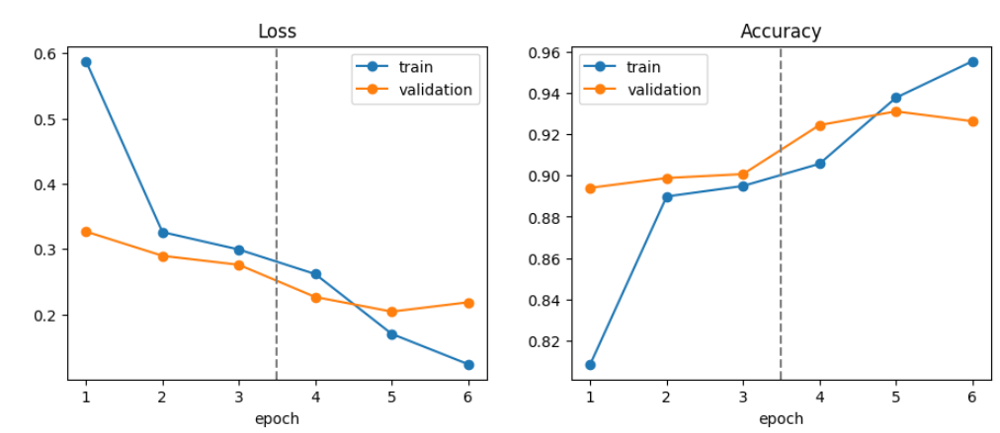
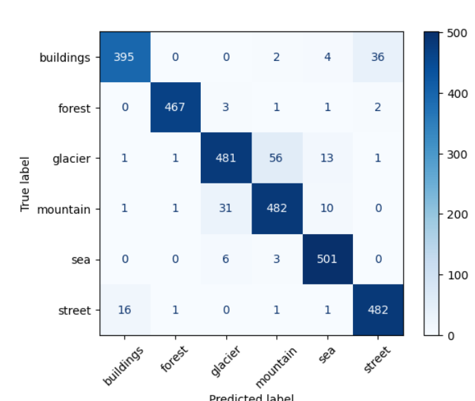
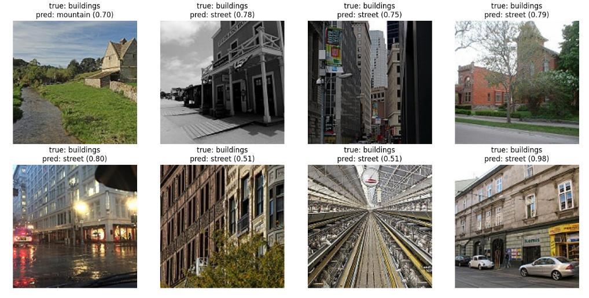

Scene Classification with Transfer Learning

Project 2, Week 5 of Introduction to Applied AI (BS Electronics, 8th semester).

I used a ResNet-18 pretrained on ImageNet to classify 6 kinds of scenes: buildings, forest, glacier, mountain, sea and street. It reached 93.6% accuracy on 3,000 test photos it had never seen, and I trained only a small part of the network to get there. This repo holds the Kaggle notebook and my notes on what the model learned and where it fails.

Summary

- Test accuracy: 0.936 (2,808 of 3,000), macro F1 0.937
- Best validation accuracy: 0.901 with only the new head trained, 0.931 after fine-tuning the last block
- Trainable parameters: 3,078 in phase 1 and 8,396,806 in phase 2, out of 11,179,590
- Hardware: Kaggle notebook, GPU T4 x2, about 36 to 40 seconds per epoch
- Data: Intel Image Classification, 14,034 training photos and 3,000 test photos, split into 11,929 train, 2,105 validation and 3,000 test

How I trained it

Photos are 150 x 150, so I resized them to 224 x 224 and normalised them with the ImageNet mean and std, because the pretrained filters expect inputs scaled that way. Without it they would see values between 0 and 1 instead of roughly -2 to +2.

Augmentation (random crop, horizontal flip, colour jitter) is applied only to the training photos. Validation and test stay clean, so their scores are honest. It also explains why my training accuracy in epoch 1 (0.809) was below my validation accuracy (0.894): the training photos were harder.

Phase 1, feature extraction (3 epochs): the whole network is frozen and only a new 512 to 6 linear layer is trained, with learning rate 1e-3.

Phase 2, fine-tuning (3 epochs): the last block, layer4, is unfrozen. It gets learning rate 1e-4 because it already holds good weights, while the new head, which starts random, keeps 1e-3.

Epoch by epoch (validation accuracy)

- Epoch 1: 0.894
- Epoch 2: 0.899
- Epoch 3: 0.901 (end of phase 1)
- Epoch 4: 0.924 (layer4 unfrozen)
- Epoch 5: 0.931 (best, kept)
- Epoch 6: 0.926

At epoch 6 the validation loss rose (0.204 to 0.219) while the training loss kept falling (0.170 to 0.124), which is the start of overfitting. I kept the epoch 5 weights.

The test set was used once, after all choices were made on the validation set.

Results per class

Precision and recall on the 3,000 test photos:

- buildings: precision 0.956, recall 0.904
- forest: precision 0.994, recall 0.985
- glacier: precision 0.923, recall 0.870
- mountain: precision 0.884, recall 0.918
- sea: precision 0.945, recall 0.982
- street: precision 0.925, recall 0.962

Where the model is wrong

192 of the 3,000 test photos were misclassified. The largest groups:

- glacier predicted as mountain: 56
- buildings predicted as street: 36
- mountain predicted as glacier: 31
- street predicted as buildings: 16
- glacier predicted as sea: 13

Glacier is the weakest class by recall (0.870) and mountain has the lowest precision (0.884), and both come from the same problem: snowy peaks, rock and sky look alike. The second problem is buildings and street, since photos of street-side buildings fit both labels.

Before I saw the results I expected buildings and glacier to be confused. I had not written that down at the time, and it was wrong: those two were mixed up only 0 and 1 times.

What the error gallery shows, and what it does not

The gallery shows the first 8 mistakes in file order. The test photos are sorted by class, so all 8 happen to be buildings. That means the gallery is not a random sample, and the biggest problem (glacier and mountain) is not in it. Next time I would plot a random sample of errors.

Mistakes I looked at closely:

- A stone house beside a stream, labelled buildings, was predicted as mountain (0.70). The landscape fills most of the photo, so I cannot blame the model much.
- A building on a street was predicted as street with 0.98 confidence. High confidence does not mean a correct answer.
- A photo of long rails inside a hall is labelled buildings. The model said street, but only with 0.51, and I doubt the label itself.

Problems I ran into

1. The first time I ran the model cell I got a URLError (temporary failure in name resolution). Internet was switched off in the Kaggle settings, so the pretrained weights could not download.
2. My first data path gave a FileNotFoundError. On my account the dataset was under /kaggle/input/datasets/puneet6060/intel-image-classification, not the path in the instructions. I found it by listing /kaggle/input.
3. After the session went idle, cells failed with "name 'model' is not defined". The variables were gone even though the old outputs were still on screen. Running everything again from the top fixed it.
4. Running the whole notebook again changed the results slightly (test accuracy moved between 0.935 and 0.936), even with a fixed seed. The numbers in this repo are from the saved version.

Hand calculations

- A 3x3 convolution on a 3-channel image with 64 filters has (3x3x3 + 1) x 64 = 1,792 parameters. A dense layer on the same 150x150x3 image would need 34,560,512, which is 19,286 times more. This is weight sharing.
- My edge detector gave [30, 30, 0] on every row, the same as in the lecture.
- For the first test photo the logit of the true class was about 8.0 and all the others were negative, so softmax gave probability 1.000 to buildings.

What I would do next time

- Look at the glacier and mountain errors by hand to check for wrong labels, then try stronger augmentation or a larger backbone such as ResNet-50.
- Plot a random sample of errors instead of the first 8.
- Stop after epoch 5 or add regularisation, since epoch 6 started to overfit.
- Remember that 94 to 95% may be close to the limit of this dataset because some labels are ambiguous.

How to run it

In Kaggle, create a notebook, turn GPU and Internet on, add the dataset Intel Image Classification (puneet6060), and run the notebook in this repo from top to bottom.

File: week-5-transfer-learning (3).ipynb

Next: Week 6 proposal

Problem: Pneumonia is a leading cause of illness in children, and reading chest X-rays takes a trained radiologist, who may not be available everywhere. I want to test whether a transfer learning model can tell a normal chest X-ray from a pneumonia one, as a learning project and not as a diagnostic tool.

Who it could help: Clinics with few radiologists, as a second opinion that flags X-rays for a doctor to check first.

Data: Chest X-Ray Images (Pneumonia) on Kaggle (Paul Mooney), 5,863 X-ray images in 2 classes, Normal and Pneumonia (5,216 train, 624 test, 16 validation). License CC BY 4.0, so I will cite Kermany et al., Cell, 2018.
https://www.kaggle.com/datasets/paultimothymooney/chest-xray-pneumonia

Plan: Reuse the Week 5 pipeline (ResNet-18, feature extraction then fine-tuning). The validation folder has only 16 images, so I will make my own train, validation and test split. The classes are not balanced, so I will report recall for pneumonia and not only accuracy. I will not use horizontal flip, since it moves the heart to the wrong side of the X-ray.
